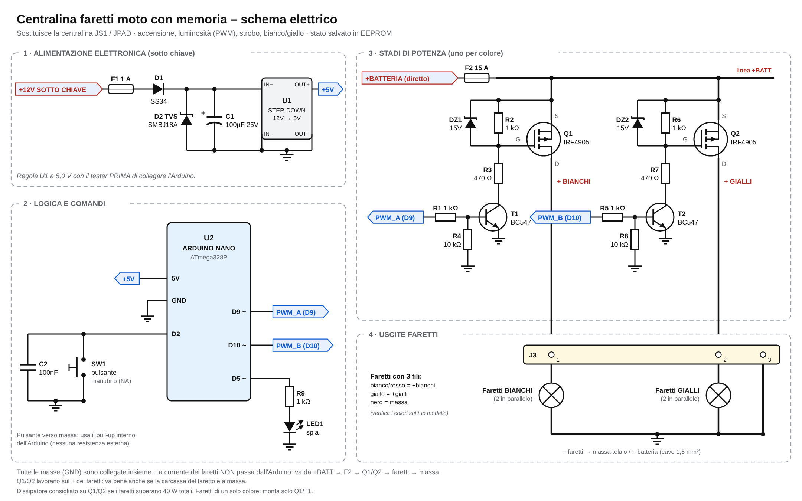
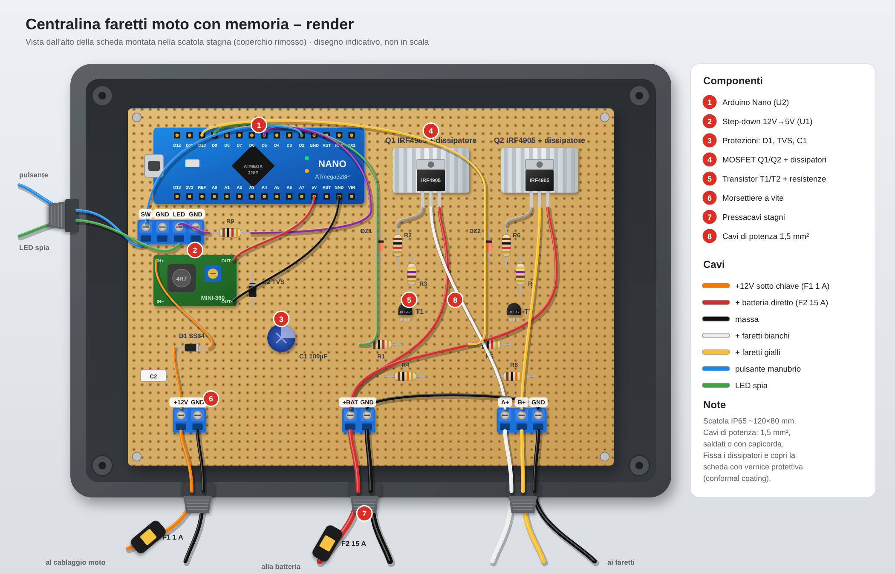

# Centralina faretti moto con memoria

Centralina per **faretti piccoli da moto** che **ricorda tutto anche dopo aver
tolto la chiave**: se erano accesi, la luminosità, lo strobo e il colore.
Sostituisce le centraline tipo **JS1 / JPAD**, che sono alimentate sotto
chiave, non hanno batteria tampone e a ogni accensione ripartono da "spento".

| Schema elettrico | Render |
|---|---|
|  |  |

I file vettoriali `schema.svg` e `render.svg` si possono ingrandire senza
perdere qualità.

## Funzioni

- Accensione e spegnimento.
- **Luminosità regolabile** in modo continuo (PWM).
- **Strobo** (doppio lampo, la sequenza si modifica nel codice).
- **Bianco / giallo / entrambi** con i faretti a doppio colore (3 fili).
- **Memoria**: l'Arduino è alimentato sotto chiave, quindi a moto spenta
  consuma zero, e lo stato viene salvato nella **EEPROM**, una memoria che non
  si cancella quando manca la corrente.
- Accensione ritardata di 1,5 s, per non accendere i faretti durante
  l'avviamento, e accensione morbida in 0,3 s.

## Comandi (un solo pulsante al manubrio)

| Azione | Effetto |
|---|---|
| **1 click** | accende / spegne |
| **2 click** | luce fissa ↔ strobo |
| **3 click** | colore: bianco → giallo → entrambi |
| **tieni premuto** | regola la luminosità: rilascia quando ti piace. Alla pressione successiva la regolazione va nel verso opposto |

Lo stato viene salvato **2 secondi dopo l'ultima modifica**. Se cambi qualcosa
e togli la chiave entro 2 s, quell'ultima modifica non viene ricordata.

### Impostazioni nel codice (`faretti_memoria.ino`)

| Costante | A cosa serve |
|---|---|
| `NUM_CANALI` | `1` = faretti di un solo colore, `2` = bianco + giallo |
| `LUM_MIN` | luminosità minima |
| `RAMPA_MS` | velocità della regolazione |
| `SEQUENZA_STROBO` | tempi del lampeggio in ms (acceso, spento, acceso…) |
| `RIPRISTINA_STROBO` | `false` = alla riaccensione lo strobo riparte come luce fissa |

## Componenti

### Base

| Q.tà | Componente | Sigla |
|---|---|---|
| 1 | Arduino Nano (ATmega328P) | U2 |
| 1 | Step-down 12 V → 5 V (mini-360 o LM2596) | U1 |
| 1 | Diodo Schottky SS34 o 1N5819 | D1 |
| 1 | Diodo TVS SMBJ18A (o P6KE18A) | D2 |
| 1 | Condensatore elettrolitico 100 µF 25 V | C1 |
| 1 | Condensatore ceramico 100 nF | C2 |
| 2 | Portafusibili a lama + fusibili 1 A e 15 A | F1, F2 |
| 1 | Pulsante NA da manubrio (va bene quello della JS1) | SW1 |
| 1 | LED spia + resistenza 1 kΩ *(facoltativo)* | LED1, R9 |
| 1 | Basetta millefori ~100×80 mm | |
| 4 | Morsettiere a vite passo 5 mm (2 da 2 poli, 1 da 3, 1 da 4) | |
| 1 | Scatola stagna IP65 + 3–4 pressacavi PG7 | |
| — | Cavo 1,5 mm² (potenza) e 0,5 mm² (segnali), guaina termorestringente | |

### Per ogni canale (×2 per bianco + giallo, ×1 per un solo colore)

| Q.tà | Componente | Sigla canale A / B |
|---|---|---|
| 1 | MOSFET P-channel **IRF4905** (TO-220) + dissipatore | Q1 / Q2 |
| 1 | Transistor NPN **BC547** (o 2N2222) | T1 / T2 |
| 1 | Resistenza 1 kΩ (base) | R1 / R5 |
| 1 | Resistenza 1 kΩ (gate–source) | R2 / R6 |
| 1 | Resistenza 470 Ω (collettore) | R3 / R7 |
| 1 | Resistenza 10 kΩ (base–massa) | R4 / R8 |
| 1 | Diodo Zener 15 V (BZX55C15) | DZ1 / DZ2 |

Resistenze da 1/4 W. Spesa totale indicativa: **30–40 €**.

## Collegamenti

Vedi `schema.svg`. In breve:

1. **+12 V sotto chiave** → F1 1 A → D1 → step-down → **5 V dell'Arduino**.
   Il TVS e C1 vanno tra l'ingresso dello step-down e la massa.
2. **+ batteria diretto** → F2 15 A → **source** di Q1 e Q2 (piedino destro
   dell'IRF4905, guardandolo dal lato scritto).
3. **Drain** di Q1 (piedino centrale) → + faretti bianchi. **Drain** di Q2 →
   + faretti gialli.
4. **Negativo dei faretti** → massa (telaio o − batteria).
5. Pulsante tra **D2** e massa. Uscite **D9** (canale A) e **D10** (canale B)
   verso le resistenze di base R1 / R5.

Perché i relè non vanno più bene: un relè non regge lo strobo (si consuma in
poco tempo) e non può regolare la luminosità. I MOSFET IRF4905 commutano il
**positivo** dei faretti, quindi funzionano anche se la carcassa del faretto è
a massa.

**Prima di collegare l'Arduino**, regola lo step-down a **5,0 V** con il tester.

## Caricare il programma

1. Installa l'[Arduino IDE](https://www.arduino.cc/en/software).
2. Apri `faretti_memoria/faretti_memoria.ino`.
3. Scegli la scheda *Arduino Nano* (processore *ATmega328P*, oppure
   *ATmega328P (Old Bootloader)* sui cloni economici) e la porta USB giusta.
4. Clicca su **Carica**.

## Avvertenze

- Su strada pubblica lo **strobo e i faretti non omologati non sono ammessi**
  dal Codice della Strada. Usa lo strobo solo dove è consentito.
- Non collegare la centralina al **+ permanente**: resterebbe sempre accesa e
  scaricherebbe la batteria della moto.
- Monta la scatola lontano da motore e scarico. Fissa bene i dissipatori e
  proteggi la scheda con vernice protettiva (conformal coating).
